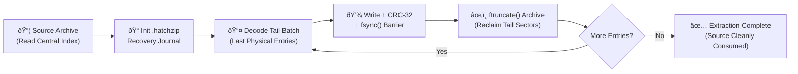

<div align="center">

  

  # HatchDroid

  **True In-Place, Zero-Overhead Archive Extraction for Android**<br>
  *An unofficial community fork & native Android port powered by the [`hatchzip-core`](https://github.com/xevrion/hatchzip) Rust engine.*

  <p>
    <a href="https://github.com/rsshir60/hatchdroid/actions"></a>
    <a href="https://github.com/rsshir60/hatchdroid/releases"></a>
    <a href="#android-app-hatchdroid"></a>
    <a href="https://github.com/xevrion/hatchzip"></a>
    <a href="#safety-guarantees"></a>
    <a href="#license--attribution"></a>
    <a href="https://github.com/rsshir60/hatchdroid/stargazers"></a>
  </p>

  <h4>
    <a href="#important-community-fork-notice">Fork Notice</a> •
    <a href="#the-problem--solution">The Breakthrough</a> •
    <a href="#android-app-hatchdroid">Android App</a> •
    <a href="#supported-formats">Formats</a> •
    <a href="#how-in-place-extraction-works">How It Works</a> •
    <a href="#safety-guarantees">Safety</a> •
    <a href="#building-from-source">Build & Verify</a> •
    <a href="#frequently-asked-questions">FAQ</a> •
    <a href="#desktop--cli-upstream-hatchzip">Desktop & CLI</a>
  </h4>

  <br>

  

</div>

---

<a id="important-community-fork-notice"></a>
## ⚠️ Important Community Fork Notice

> [!IMPORTANT]
> **Unofficial Community Fork & Android Port**
>
> This repository is an **independent community fork** maintained by [@rsshir60](https://github.com/rsshir60). We are **not** the official developers or owners of the HatchZip project.
>
> All credit for the invention of the in-place extraction algorithm, the core Rust engine (`hatchzip-core`), and the original desktop/CLI applications belongs to **[xevrion/hatchzip](https://github.com/xevrion/hatchzip)**. Please visit **[hatchzip.dev](https://hatchzip.dev)** for official desktop builds and upstream releases.
>
> **Scope of This Fork:** Our work focuses exclusively on bringing the `hatchzip-core` ecosystem to Android through **HatchDroid**—introducing a native Jetpack Compose UI, UniFFI/JNI bindings, a dual-progress Android Foreground Service, Android FUSE / Scoped Storage resilience, and 16 KB ELF page alignment for Android 15+.

---

<a id="the-problem--solution"></a>
## 💡 The Problem & Solution

Traditional archive extractors (WinRAR, 7-Zip, ZArchiver, Files by Google) require **2× disk space** during extraction: enough room to hold the compressed archive **and** all uncompressed files simultaneously.

```text
❌ Traditional Extraction (Requires 2× Storage):
┌───────────────────────────┬─────────────────────────────┐
│    30 GB Source Archive   │    32 GB Unpacked Files     │  => 62 GB Peak Required
└───────────────────────────┴─────────────────────────────┘
Result on a phone with 35 GB free: FAILS ("Out of Storage Space")

✅ HatchDroid In-Place Extraction (Powered by hatchzip-core):
┌──────────────┐             ┌─────────────────────────────┐
│ 15 GB Carved │ ──freed──>  │    16 GB Hatched Files      │  => ~33 GB Peak Required
└──────────────┘             └─────────────────────────────┘
Result on a phone with 35 GB free: SUCCEEDS (Source shrinks as files hatch)
```

| Real-World Scenario | Standard Mobile Extractors | 🐣 HatchDroid |
|:---|:---:|:---:|
| **30 GB archive on a phone with 35 GB free** | ❌ Fails (*Out of Space*) | ✅ **Extracts smoothly** |
| **Disk space reclamation** | ⏳ Only after 100% completion | ⚡ **Continuous, real-time tail truncation** |
| **App killed / Battery dies at 80%** | ⚠️ Partial/corrupt files; restart from 0% | 🛡️ **Instant, bit-for-bit crash-safe resume** |
| **Disk space validation** | ❌ Writes blindly until storage hits 0 B | 🔍 **Simulates full extraction timeline before touching disk** |
| **Split multi-volume sets (`.001`, `.part1.rar`)** | ❌ Keeps all parts until the very end | 🗑️ **Purges each volume immediately after extraction** |

---

<a id="android-app-hatchdroid"></a>
## 📱 Android App (HatchDroid)

HatchDroid pairs the memory-safe Rust `hatchzip-core` engine with a native Material 3 Jetpack Compose interface tailored for mobile storage constraints.

<div align="center">
  
</div>

### ✨ Key Android Capabilities
- 🗜️ **True In-Place Storage Reclaimer:** Truncates random-access archives from the tail via POSIX `ftruncate`, and punches sparse filesystem holes in forward-streamed `tar.gz` archives via `fallocate(FALLOC_FL_PUNCH_HOLE)`.
- 📊 **Pre-Flight Space Telemetry:** Inspects archive headers before modifying a single byte on disk, rendering a visual Before vs. After storage bar to guarantee the extraction fits.
- 🛑 **System Safety Buffer Enforcement:** Reserves a protected free-space floor (default 2 GB) so Android never hits zero storage or starves system SQLite databases.
- 🔔 **Foreground Service with Live Dual-Progress:** Runs resiliently in the background with persistent notification telemetry tracking both directions simultaneously:
  - 🔻 **Archive Reclaimed:** e.g., `24.5 GB / 30.0 GB reclaimed`
  - 🔺 **Files Hatched:** e.g., `26.2 GB / 32.0 GB extracted`
- 🔄 **Crash-Proof & Resumable (`.hatchzip` Journal):** If Android force-stops the background task or the battery dies, atomic flush barriers and state checkpoints let you reopen HatchDroid and tap **Resume Safely**.
- 🧩 **Android 15+ Ready (16 KB Page Alignment):** Native Rust shared libraries (`libhatchzip_android.so`) are compiled and verified with 16 KB ELF segment alignment for modern ARM64 hardware.
- 🔒 **100% Offline & Zero Telemetry:** No internet permission, no ads, no analytics SDKs, and zero network dependencies.

> [!NOTE]
> Full Google Play Store metadata, permission rationales, and privacy declarations are documented in [`docs/play_store_listing.md`](docs/play_store_listing.md).

---

<a id="supported-formats"></a>
## 📦 Supported Formats & Reclamation Granularity

| Format | Compression Codecs Supported | Space Reclaimed Every | Mechanism |
|:---|:---|:---:|:---|
| **ZIP / ZIP64** | Stored, Deflate, Deflate64, Bzip2, LZMA, PPMd, XZ, Zstd | **1 File** | Reverse tail `ftruncate` |
| **7-Zip (`.7z`)** | LZMA, LZMA2, BCJ, Bzip2, Deflate, PPMd, Zstd | **1 Solid Block** | Reverse block `ftruncate` |
| **RAR (RAR4 & RAR5)** | Full single-archive & multi-part (`.part1.rar`) | **1 File / Volume** | Tail `ftruncate` / Volume delete |
| **TAR (Uncompressed)** | POSIX ustar, GNU tar, long filenames, symlinks | **1 File** | Reverse tail `ftruncate` |
| **TAR.GZ / `.tgz`** | Gzip-compressed TAR streams | **256 MiB Chunk** | Forward `fallocate` hole-punching |
| **Split Archives** | `.001`, `.002`, `.part1.rar`, `.z01`, `.7z.001` | **1 Volume** | Immediate volume `unlink` |
| **Encrypted Archives** | ZipCrypto, AES-128, AES-256, RAR5 AES, 7z AES | Same as base format | Authenticated decrypt + truncate |

---

<a id="how-in-place-extraction-works"></a>
## ⚙️ How In-Place Extraction Works

Standard extractors stream from byte 0 to EOF, keeping the entire source file locked on disk until the last byte is unpacked. HatchDroid reverses the pipeline:



1. **Reverse Ingestion:** For indexed formats (ZIP, 7z, RAR), the Central Directory lives at the end of the file. The engine parses this index first and writes a compact `.hatchzip` recovery journal to disk.
2. **Tail-to-Head Batching:** Entries located physically closest to the end of the archive are decoded and extracted first.
3. **Atomic Flush Barrier:** Each extracted file is written, checksum-verified (CRC-32), and flushed to physical flash storage via `fsync`.
4. **Tail Truncation:** Only after the hardware flush succeeds does HatchDroid call `ftruncate` to chop the processed bytes off the end of the source archive.
5. **Immediate Sector Reclamation:** The Android filesystem (`ext4` / `f2fs` / `FUSE`) immediately marks those freed blocks as available for the next batch of extracted files.

```text
Initial State:  [ Entry 1 | Entry 2 | Entry 3 | Entry 4 | Central Index ]
Step 1:         [ Entry 1 | Entry 2 | Entry 3 ] ──> (Entry 4 written, verified & synced)
Step 2:         [ Entry 1 | Entry 2 ]           ──> (Entry 3 written, verified & synced)
Step 3:         [ Entry 1 ]                     ──> (Entry 2 written, verified & synced)
Final State:    [ Original archive cleanly consumed; 100% of files hatched on disk ]
```

---

<a id="safety-guarantees"></a>
## 🛡️ Safety & Storage Resilience Guarantees

Because in-place extraction mutates the source archive, `hatchzip-core` enforces strict transactional invariants:

- **Pre-Flight Timeline Simulation:** Computes the exact high-water mark across every single file batch before touching disk. If peak usage ever breaches `--keep-free` (default 2 GB), extraction refuses to start.
- **Strict Write → Flush → Truncate Ordering:** An archive byte range is never truncated until every file inside that range is completely written, checksummed, and synced to non-volatile storage.
- **Real-Time CRC-32 Integrity Checks:** Every extracted stream is verified against its header checksum on the fly. Any bit-rot or corruption halts the pipeline immediately before truncation occurs.
- **Path Traversal & Zip-Slip Hardening:** Sanitizes relative paths (`../`), rejects absolute paths, validates symlink targets, and prevents arbitrary permission escalation.
- **Android FUSE & External SD Card Fallbacks:** Engineered with graceful fallbacks for Android's `/storage/emulated/0` FUSE daemon and FAT32/exFAT mounts where POSIX advisory locks (`ENOSYS`), `fchmod` (`EPERM`), or `syncfs` are unsupported by the kernel driver.

---

<a id="monorepo-architecture"></a>
## 🗂️ Monorepo Architecture

```text
hatchdroid/
├── android-app/            # 📱 Native Jetpack Compose Android Application [Fork Addition]
│   ├── app/                # Material 3 UI, ViewModels, Foreground Service, Space Telemetry
│   ├── gradle/             # Kotlin Gradle DSL & version catalogs
│   └── scripts/            # 16 KB ELF alignment verification & release signing tools
├── crates/
│   ├── android/            # 🦀 UniFFI + JNI bridge exposing Rust core to Kotlin [Fork Addition]
│   ├── uniffi-bindgen/     # 🛠️ UniFFI Kotlin bindings generator [Fork Addition]
│   ├── core/               # ⚙️ Upstream in-place extraction engine (hatchzip-core)
│   ├── cli/                # 💻 Upstream command-line interface (hatchzip)
│   ├── gui/                # 🖥️ Upstream desktop GUI application
│   └── shell/              # 🪟 Upstream Windows Explorer context-menu extension
├── docs/                   # Architecture deep dives, format specs, Play Store metadata
├── scripts/                # Cross-compilation build scripts (PowerShell & Bash)
└── assets/                 # App icons, SVGs, and demo media
```

---

<a id="building-from-source"></a>
## 🏗️ Building from Source

### Prerequisites
- **Rust:** Stable toolchain via [rustup](https://rustup.rs/) (`aarch64-linux-android` and `x86_64-linux-android` targets)
- **Android SDK & NDK:** API 33+ and NDK r27+ (required for 16 KB ELF page alignment)
- **JDK:** Java 21+

### 1. Build HatchDroid (Android Native Libraries + APK)

**Windows (PowerShell):**
```powershell
# Cross-compiles Rust core with 16 KB page alignment & generates UniFFI bindings
.\scripts\build-android.ps1 -Release

# Assemble signed/unsigned release APK & AAB
cd android-app
.\gradlew assembleRelease bundleRelease
```

**Linux / macOS (Bash):**
```bash
# Cross-compiles Rust core with 16 KB page alignment & generates UniFFI bindings
./scripts/build-android.sh --release

# Assemble release APK & AAB
cd android-app
./gradlew assembleRelease bundleRelease
```

### 2. Verify 16 KB Page Alignment & APK Signature

```bash
# 1. Verify ELF LOAD segments are 16 KB (0x4000) aligned
llvm-readelf -l target/aarch64-linux-android/release/libhatchzip_android.so | grep -E "LOAD|Align"

# 2. Verify APK zipalign at 16 KB boundaries
zipalign -c -P 16 -v 4 android-app/app/build/outputs/apk/release/app-release.apk

# 3. Verify APK v2/v3 cryptographic signature
apksigner verify --verbose android-app/app/build/outputs/apk/release/app-release.apk
```

### 3. Build Upstream Desktop & CLI Tools

```bash
cargo build --release --workspace --exclude hatchzip-android

# Compiled binaries:
# target/release/hatchzip      (CLI)
# target/release/hatchzip-gui  (Desktop GUI)
```

---

<a id="desktop--cli-upstream-hatchzip"></a>
## 💻 Desktop & CLI (Upstream HatchZip)

The desktop GUI and command-line interface (`hatchzip`) included in this monorepo are authored and maintained upstream by **[xevrion/hatchzip](https://github.com/xevrion/hatchzip)**.

For official prebuilt desktop installers (`.msi`, `.dmg`, `.deb`, `.rpm`, `.AppImage`) and provenance attestations:
- 🌐 **Official Website:** [hatchzip.dev](https://hatchzip.dev)
- 📦 **Official Desktop Releases:** [github.com/xevrion/hatchzip/releases](https://github.com/xevrion/hatchzip/releases)

```bash
# Preview the exact storage high-water mark without modifying disk
hatchzip check huge_game.zip

# Extract in-place (shrinks source archive as files hatch)
hatchzip extract huge_game.zip

# Extract a multi-volume split archive (any part filename works)
hatchzip x game.7z.001

# Extract traditionally without truncating the original archive
hatchzip extract archive.zip --keep-archive

# Resume an interrupted extraction after power loss or Ctrl+C
hatchzip extract huge_game.zip
```

---

<a id="frequently-asked-questions"></a>
## ❓ Frequently Asked Questions

<details>
<summary><b>1. Why does HatchDroid require "All Files Access" (<code>MANAGE_EXTERNAL_STORAGE</code>)?</b></summary>
<br>

HatchDroid is a low-level archive management tool that operates directly on multi-gigabyte archives across user directories (e.g., `/storage/emulated/0/Download`). Android's standard Storage Access Framework (`content://` URIs) cannot perform POSIX random-access tail truncation (`ftruncate`) or hole-punching (`fallocate`). Direct file path access is strictly required to progressively shrink files on disk and manage crash-recovery companion journals (`.hatchzip`). HatchDroid operates 100% offline and requests zero internet permissions.
</details>

<details>
<summary><b>2. Does in-place extraction cause excessive flash memory wear (UFS / eMMC)?</b></summary>
<br>

**No.** In fact, in-place extraction causes **equal or fewer total flash write cycles** than traditional extraction:
- Extracted files are written sequentially to disk exactly once in both methods.
- Truncating the archive tail via `ftruncate` only updates the file's metadata index in the filesystem inode / block allocation table—it does not overwrite the data sectors.
- In-place extraction prevents Android's memory manager from thrashing low-storage swap space during tight storage conditions.
</details>

<details>
<summary><b>3. How does tail truncation interact with Android's FUSE filesystem?</b></summary>
<br>

Android runs a userspace FUSE wrapper over `/storage/emulated/0` to manage Scoped Storage permissions. Some legacy extractors fail because Android's FUSE daemon returns `ENOSYS` or `EOPNOTSUPP` on POSIX advisory file locks (`flock`) or directory sync operations (`syncfs`). HatchDroid's modified platform driver handles these specific FUSE quirks by falling back gracefully, ensuring reliable tail truncation across internal storage and FAT32/exFAT SD cards.
</details>

<details>
<summary><b>4. What happens if the app crashes, battery dies, or Android kills the process?</b></summary>
<br>

**Your files remain completely safe.** HatchDroid maintains a two-file recovery journal (`archive.zip.hatchzip` and `archive.zip.hatchzip-tail`) holding the archive's central directory. Every file is completely extracted, verified against its CRC-32 checksum, and synced via `fsync` before the source archive is truncated. If extraction is interrupted at any moment, reopen HatchDroid and tap **Resume**—it will read the journal and pick up seamlessly from the exact byte where it left off.
</details>

<details>
<summary><b>5. Can I use HatchDroid as a normal extractor without altering the source archive?</b></summary>
<br>

**Yes.** If your device has sufficient storage, toggle **"Keep Archive"** in HatchDroid's settings. In this mode, HatchDroid operates as a traditional, non-destructive extractor: the source archive is untouched, and full extraction space is allocated as normal.
</details>

---

<a id="license--attribution"></a>
## 📄 License & Attribution

This project is dual-licensed under your choice of:
- **[Apache License, Version 2.0](LICENSE-APACHE)**
- **[MIT License](LICENSE-MIT)**

### Upstream Attribution & Acknowledgments
- **Original Engine & Algorithm (`hatchzip-core`):** Created and maintained by **[xevrion](https://github.com/xevrion)** at **[xevrion/hatchzip](https://github.com/xevrion/hatchzip)** ([hatchzip.dev](https://hatchzip.dev)).
- **HatchDroid (Android Port):** Created and maintained by **[@rsshir60](https://github.com/rsshir60)** as a community fork bringing `hatchzip-core` to Android.
- **UnRAR:** RAR format extraction uses the UnRAR library under its respective [freeware license](LICENSE-UNRAR).

---

<div align="center">
  <b>⭐ Star this repo if it saved your phone storage!</b><br>
  Check out the original upstream project at <a href="https://github.com/xevrion/hatchzip">xevrion/hatchzip</a>.
</div>
